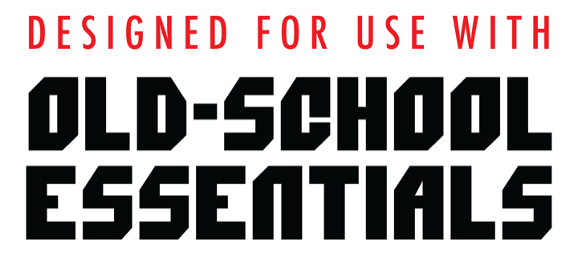

# Character Sheets

A small native Mac app for Old-School Essentials characters. The sheet fills
in what the rules decide (saves, attacks, AC, movement, level-ups) and keeps
every character in a plain Markdown file with a YAML header.

## Try the beta

The app is in open beta on TestFlight:
**[Join the beta](https://testflight.apple.com/join/dzUYmAAh)**

- You need macOS 15 or later and Apple's TestFlight app (the link offers it).
- Requires Old-School Essentials. The app knows the Classic Fantasy
  classes' numbers; the rules themselves are in the books.
- It's a beta: keep copies of characters you care about. Each one is a
  plain text file, so a backup is just a copy of the file.
- Send feedback from Help → Send Feedback… in the app, with TestFlight's
  screenshot feedback, or by opening an issue here.

<picture>
  <source srcset="site/images/designed-for-ose-dark.png" media="(prefers-color-scheme: dark)">
  
</picture>

Character Sheets is an independent app. It isn't an official Old-School
Essentials product, and isn't affiliated with or approved by Necrotic Gnome.
Old-School Essentials is a trademark of Necrotic Gnome. The trademark and
Old-School Essentials logo are used with permission of Necrotic Gnome, under
license.

## Docs

- Plan and roadmap: [`docs/PLAN.md`](docs/PLAN.md)
- File format: [`docs/FILE-FORMAT.md`](docs/FILE-FORMAT.md)
- PDF import notes: [`docs/PDF-IMPORT.md`](docs/PDF-IMPORT.md)

## Layout

| Path | What |
|---|---|
| `App/` | The macOS app (SwiftUI, document-based). Files added here are picked up by Xcode automatically. |
| `Config/` | Info.plist (document types) and entitlements |
| `Packages/CharacterKit/` | Reading and writing character files. No UI; shared with a future iPad app. |
| `Packages/CharacterKit/Sources/CharacterKit/Resources/ose/` | OSE Classic rules data (JSON), bundled with the app |
| `schema/` | JSON Schema for the file header |
| `examples/` | Example characters. Also test fixtures: every file must round-trip byte for byte. |

## Build and test

Requires Xcode 16 or later. The app runs on macOS 15+.

```sh
# App
open "Character Sheets.xcodeproj"        # then Run (⌘R)

# CharacterKit tests (or choose the CharacterKit scheme in Xcode and press ⌘U)
cd Packages/CharacterKit && swift test
```

The bundle id is `com.mitchellhudson.CharacterSheets`, signed automatically
with team `753UQ7TNXJ`. To send a build to TestFlight, run
`scripts/testflight.sh` (see `docs/RELEASING.md`).

Third-party notices (Yams, MIT; OSE SRD rules data, OGL 1.0a; the
Old-School Essentials third-party license) are in `App/Help/Legal.swift`,
shown in About and Help → Licenses and Legal. The full OGL text ships in the
CharacterKit resource bundle.
